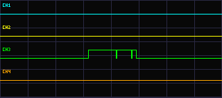
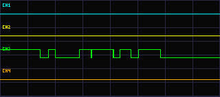
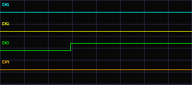

# Analizator logiczny PyPortal

Czterokanałowy analizator logiczny sterowany dotykowo dla **Adafruit PyPortal M4
(SAMD51)**. Program jest szkicem Arduino zapisanym w pliku `Analizator.ino`.
Wbudowany ekran i ekran dotykowy PyPortala obsługuje biblioteka Adafruit Arcada.

## Wejścia i obsługa

- D4 to kanał 1 (CH1, turkusowy), D3 to kanał 2 (CH2, żółty), SWC/SWCLK to
  kanał 3 (CH3, zielony), a SWD/SWDIO to kanał 4 (CH4, pomarańczowy).
- Pinout wejść D3/D4:

  | Oznaczenie PyPortala | Kanał analizatora | Pin Arduino | Pin mikrokontrolera | Złącze/pad |
  | --- | --- | --- | --- | --- |
  | D3 | CH2, żółty | `3` | PA04 | sygnał złącza JST SENSE |
  | D4 | CH1, turkusowy | `4` | PA05 | sygnał złącza JST NEOPIX |

  Podłącz sygnał do pinu sygnałowego odpowiedniego złącza JST, a masę badanego
  układu do GND PyPortala. Zwróć uwagę, że CH1 jest przypisany do D4, a CH2 do
  D3. Nie podawaj napięcia na linię zasilania złącza.
- Pady SWC i SWD są liniami debugowania mikrokontrolera użytymi tu jako GPIO.
  Podłączenie ich jako wejść wyłącza debugowanie przez SWD podczas działania
  analizatora. Wgrywanie programu przez USB pozostaje dostępne.
- Przy wykresie kanały są opisane **CH1–CH4**. Obok każdej etykiety wyświetlany
  jest ostatni stan: **H** oznacza stan wysoki, a **L** stan niski. Podczas
  pauzy wskaźniki pokazują bieżący stan wejść.
- Połącz masę badanego układu z masą PyPortala.
- Wejścia obsługują wyłącznie logikę **3,3 V**. Nie podłączaj bezpośrednio
  napięcia 5 V ani napięcia ujemnego. Zastosuj odpowiednie dopasowanie poziomów
  i zabezpieczenie wejść.
- **STOP / RUN** zatrzymuje lub wznawia akwizycję.
- **TRIG** przełącza tryb wyzwalania: AUTO, RISE, FALL i SINGLE.
- Przycisk **SAVE** znajduje się w górnym pasku, w miejscu tytułu. Dotknij go,
  aby zapisać przebieg na karcie microSD jako parę plików, np. `LOG000.PNG`
  i `LOG000.CSV`. Przy ustawieniach do 1 µs zapisuje szybki zrzut 320 próbek.
  Przy ustawieniach od 2 µs uruchamia 5-sekundowy pomiar w tle, grupuje próbki
  do 320 punktów wykresu i zapisuje je po zakończeniu.
  PNG to kolorowy wykres z etykietami CH1–CH4, który można otworzyć
  w przeglądarce zdjęć. CSV zawiera zarejestrowane próbki i ich czas w ns.
  Karta musi być włożona do gniazda PyPortala i sformatowana w obsługiwanym
  formacie FAT. Przycisk SAVE świeci na czerwono podczas zbierania próbek
  i zapisu na kartę. Dolny pasek pod wykresem pozostaje pusty.
- Wszystkie przyciski są zielone w stanie spoczynku. Po dotknięciu wybrany
  przycisk podświetla się na żółto. Obszar dotykowy obejmuje także odstępy
  między przyciskami oraz pas poniżej nich, by ułatwić obsługę palcem.
- AUTO rozpoczyna akwizycję również po wcześniejszym zatrzymaniu trybu SINGLE.
- **T- / T+** zmienia odstęp między próbkami w zakresie częstotliwości
  nominalnej od 8 MHz do 1 Hz: od 125 ns do 1 µs co 125 ns, a następnie
  2-5-10 w skali µs aż do 1 s.
- Aktualny odstęp próbkowania T jest wyświetlany w prawym górnym rogu, obok
  tytułu, tą samą czcionką i w tym samym rozmiarze. Dolny pasek pod wykresem
  pozostaje pusty. Tekst przycisków jest jaskrawozielony.
- Tryby RISE i SINGLE oczekują na zbocze narastające na jednym z czterech wejść, a FALL
  na zbocze opadające. Jeśli zbocze nie wystąpi, po sekundzie urządzenie
  ponawia próbę; tryb SINGLE zatrzymuje się dopiero po zarejestrowaniu przebiegu.
- SINGLE rejestruje jeden przebieg i zatrzymuje akwizycję. Dotknij **ARM**,
  aby uzbroić kolejny pomiar.

Zakres 125 ns–1 µs korzysta z krótkiego zrzutu GPIO; ekran może na moment
zatrzymać się podczas tego zrzutu. Dłuższe odstępy są próbkowane programowo,
a akwizycja wolna od 1 ms w górę działa w tle, z obsługą ekranu między
próbkami. W tych zakresach rzeczywiste taktowanie zależy od działania programu
i odświeżania wyświetlacza; częstotliwości są nominalne. Potwierdź szybkość i
jakość pomiaru sygnałem testowym oraz oscyloskopem lub analizatorem logicznym.

## Przykładowe przebiegi

Zrzuty zarejestrowane przez analizator:

## Kompilowanie i wgrywanie

W Arduino IDE wybierz **Adafruit PyPortal M4 (SAMD51)** i w razie potrzeby
zainstaluj bibliotekę Adafruit Arcada. Otwórz i skompiluj `Analizator.ino`.
Aby wgrać program, dwukrotnie naciśnij przycisk resetowania PyPortala, żeby
uruchomić bootloader, a następnie wybierz port bootloadera w Arduino IDE i
rozpocznij wgrywanie. Wgranie programu Arduino zastępuje dotychczasową aplikację
CircuitPython.
